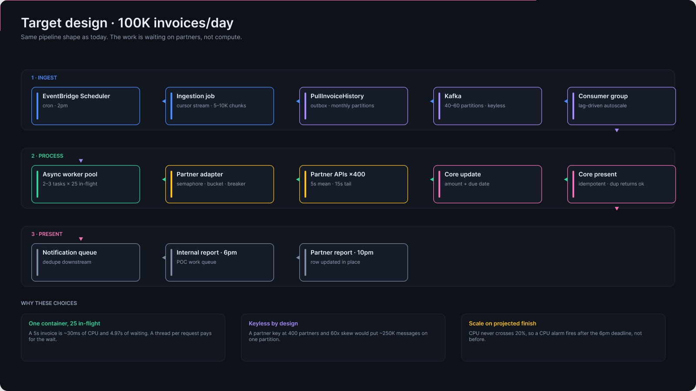
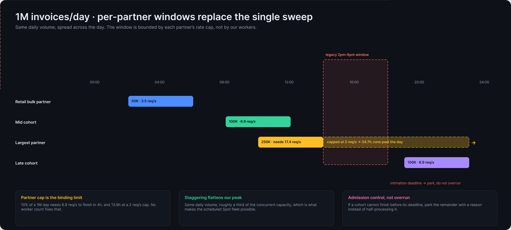

> **TL;DR:**
> The as-built design clears 50K-60K invoices a day in a four-hour window. At 100K, partitions and thread-per-invoice workers stop being enough. At 1M the partner rate limit and the SMS bill bind before capacity does.

This is the design-notes companion to [Invoice Presentation Orchestration](/blog/invoice-orchestration/). That post describes what runs today; this one asks what would have to change at 100K and 1M - which architecture shape to run it on, which component breaks first, and what would stay exactly as it is.

The current shape was sized for 50-60K and works because three things were true: 20 partitions were enough consumer parallelism, one worker thread could hold one in-flight invoice, and every partner would accept our request rate inside a common 4-hour window. At 100K the first two bend and the third still holds. At 1M all three break, and capacity stops being the interesting constraint.

## Sizing: same model, two rungs up

Running the same model forward:

| | 50K (today) | 100K | 1M |
| --- | --- | --- | --- |
| Worker-seconds required | 262,500 | 525,000 | 5,250,000 |
| Concurrency required in 4h | 18.2 → 19 | 36.5 → 37 | 364.6 → 365 |
| Sustained message rate | 3.5/s | 6.9/s | 69.4/s |
| Partitions at one in-flight per partition | 20 (current) | 37 | 365 |

*The flow every shape in the next section has to execute. Three lanes, same as today's pipeline - what changes is how many invoices one container holds at once.*

## Architecture options: five shapes for the same flow

Sizing tells you how much concurrency is needed. It does not tell you what to run it on, and at these volumes the platform choice moves the bill by more than an order of magnitude. Five shapes, all of which execute the same seven steps:

| Shape | Unit of work | Concurrency control | Modelled cost at 1M/day | What you give up |
| --- | --- | --- | --- | --- |
| As built: threaded workers on EC2, 24/7 | one thread per invoice | partitions x threads per host | ~$12,900/mo (365 threads ≈ 92 `m6i.xlarge`) | ~95% of the fleet idles; CPU is never the signal |
| Async workers on scheduled Spot | one task, 20-25 calls in flight | task count + per-partner semaphores | ~$60-150/mo | you own the scheduler and the drain-before-deadline logic |
| Serverless: scheduler → SQS → Lambda | one invocation per invoice | Lambda reserved/provisioned concurrency | ~$1,380/mo at 512MB, ~$690/mo at 256MB | per-partner bulkheads need external state; no connection reuse |
| Batch array job on Spot | one item in an array job | array size + `maxvCpus` | ~$180/mo | batch semantics, not streaming; results land in S3/DB, not a queue |
| Step Functions Distributed Map | one child execution per invoice | `MaxConcurrency` on the Map | ~$4,500-6,000/mo in state transitions alone | Standard workflows bill per transition, which dominates compute |

Every figure is modelled, not billed, on the footnote's assumptions; none of them is a quote.

### Serverless is a real option at 100K and a worse one at 1M

At 100K, Lambda costs about **$138/month** against roughly $60 for a five-hour Spot fleet. That gap is small enough to be a rounding error next to the value of not owning a fleet: EventBridge Scheduler replaces the cron and the trigger, SQS replaces Kafka and gives you redelivery, a DLQ and partial-batch failure reporting for about $12/month, and the queue's own metrics become the lag signal. If the system were being built today for 50-100K, this is the shape I would start with.

At 1M the arithmetic turns. Lambda bills per GB-second of wall time, and an invoice spends 5.5s of that waiting on a partner, so the same idle wait the as-built fleet pays for in containers comes back as $1,380/month at 512MB - roughly ten to twenty times the async Spot fleet. *Why the fleet wins:* with a fixed four-hour window you are buying time, not requests, and reserved capacity prices time far below per-invocation billing.

Three Lambda constraints matter more than the price:

- **The 15-minute ceiling applies to the sweep, not the invoice.** One invocation cannot stream a million due invoices to a queue; shard the sweep by partner cohort and accept N scheduled invocations, each with its own `request_id` shard.
- **Concurrency control is per function, not per partner.** A bulkhead in Lambda needs external state - a token bucket in DynamoDB, or one queue per partner with reserved concurrency - because there is no long-lived process to hold a per-partner semaphore.
- **No connection reuse.** Each invocation opens fresh TLS to the partner endpoint, adding a handshake to a 5.5s job and multiplying connections the partner sees at peak. At 365 concurrent that is the partner's problem to notice.

### The sweep is a batch job, and Batch says so

Strip the streaming vocabulary and this workload is: a manifest of a million invoices, a fixed four-hour deadline, a per-item retry policy, and a result set for a report. That is an array job. AWS Batch expresses it directly - array size, `maxvCpus` as the concurrency cap, per-item retry attempts, and Spot interruption handling that requeues the item - for compute cost and no per-state charge. The outbox key and idempotent present make the requeue safe, which is the only reason a Spot array is viable at all.

The same argument applies to Step Functions Distributed Map, with one caveat: it is the better tool when the per-item flow has branches worth seeing (skip, park, retry, escalate), and the worse tool on price, because Standard workflows bill per state transition. At six to eight transitions an invoice, a million invoices a day is $4,500-6,000/month before any compute. Express workflows and Batch both avoid that, which is why the orchestration layer should not be the default choice at this volume.

### Which one wins, and why

The verdict differs by rung, and the reasoning is the same in all three cases: pick the shape that matches how the work *arrives*, then check the price.

- **At 50-60K: none of them. Keep what runs today.** The fleet costs a few hundred dollars a month, the retry contract already works, and every option here re-platforms it for a saving measured in tens of dollars.
- **At 100K, from a clean sheet: serverless.** Arrival is unknown ahead of the day, volume swings 60x, and 37 invoices in flight fit inside one function's concurrency without anyone tuning a fleet. $138/month against ~$60 is not a real difference, and the queue, the retry policy, the DLQ and the lag metrics all come with it. From the existing system: keep it and move to async workers on Spot, because the same $80 does not justify re-writing ingestion and redelivery.
- **At 1M: scheduled capacity, not serverless.** A Batch array on Spot (or async workers on Spot) at roughly $180/month, with the orchestration layer left out. *Why:* the load is a fixed four-hour peak with a known deadline, which is precisely what reserved throughput prices well and what per-invocation billing prices badly; the partner rate limit, not our elasticity, is what binds; and Standard state-transition billing costs several times the compute it orchestrates.

The crossover is arithmetic rather than taste. A Lambdafied invoice costs about **$0.000046** (512MB, 5.5s, one request), so against a five-hour Spot fleet at ~$100/month the two are equal at roughly **72,000 invoices a day** - below it serverless is cheaper *and* simpler, above it the fleet pulls away and keeps going. Two caveats decide the edge cases: per-partner concurrency caps need external state under Lambda, and the 15-minute invocation ceiling means the 2pm sweep itself has to be sharded once a single job can no longer finish the enumeration.

### What every shape has to preserve

None of these options changes the part that makes retries safe: the outbox key `(request_id, sequence_number)`, present returning success for a duplicate, the amount written as a set-to-value rather than a delta, and per-partner configuration behind the template method. Those four decisions are portable across EC2, Fargate, Lambda, Batch and any orchestrator - which is the test of whether they were design decisions or accidents of the platform.

## Ingestion: shard the sweep, stream the rows

At 100K, one job is still fine, but it should stream the due-list through a server-side cursor and bulk-insert in 5-10K chunks instead of materialising the list in the application. Publishing should be a relay over the outbox rows, not a second write from the same code path. *Why:* the 2pm sweep is one large write burst, and a single 100K-row transaction holds locks and WAL for its whole duration while a crash at 90% throws away the run.

At 1M, shard the sweep by partner cohort - one ingestion job per shard, each with its own `request_id` of `date + shard`. *Why:* a million rows in one transaction is minutes of WAL, and retrying a failed run means re-deriving a million invoices. Per-shard `request_id`s make progress partial and retries cheap, and the outbox key `(request_id, sequence_number)` keeps working unchanged - `sequence_number` just restarts per shard.


flowchart LR
A["Cron @ 2pm"] --> B["Derive due list per partner cohort"]
B --> C1["Shard 1 · request_id = date + 1"]
B --> C2["Shard 2 · request_id = date + 2"]
B --> C3["Shard N · request_id = date + N"]
C1 --> D[("PullInvoiceHistory")]
C2 --> D
C3 --> D
D --> E["Kafka · keyless · 120-200 partitions"]


## Queue: keep it keyless, add partitions carefully

Keep Kafka, keep no partition key, raise the count: roughly 40-60 partitions at 100K, 120-200 at 1M.

*Why keyless is still right at 20x:* you do not need ordering - dedupe is on the row key and present is idempotent by contract - and a partner key would be actively harmful. With 400 partners and 60x volume skew, a partner carrying 25% of a 1M day puts 250K messages on a single partition and serialises the whole window behind itself. Default partitioning spreads load evenly; partner isolation belongs in the consumer as a per-partner semaphore, not in partition assignment.

*Why not 365 partitions:* partition count is only a parallelism ceiling if you assume one in-flight message per partition. Once consumers multiplex, 120 partitions each feeding 3-5 concurrent requests covers 365 in-flight without paying for rebalance time, file handles and leader elections.

## Workers: stop paying for a thread per in-flight request

This is the change that matters, because the arithmetic says the work is not compute.

At 100K: an async worker (asyncio plus aiohttp or equivalent) holding 20-25 concurrent partner calls per task, so two or three tasks cover the window. At 1M: fifteen tasks at 25 concurrent, or eight at 50.


flowchart TD
A["Poll a batch from the partition"] --> B{"Projected finish before deadline?"}
B -- no --> C["Park the cohort with a reason"]
B -- yes --> D["Acquire partner semaphore + token"]
D --> E["Fetch partner state over HTTP"]
E --> F{"Diff requires an update?"}
F -- no --> G["Present as-is"]
F -- yes --> H["Update core amount and due date"]
H --> G
G --> I["Present · duplicate returns success"]
I --> J["Enqueue customer notification"]
J --> K["Commit offset"]


*Why async:* a 5s invoice spends almost all of that waiting on someone else's HTTP endpoint. At ~30ms of CPU per invoice, a million invoices is roughly 2 vCPU sustained across the entire four-hour window. Buying 365 request slots by paying for 365 containers is paying twenty times over for the same idle time.

*Why the fleet should be elastic rather than 24/7:* the same fleet provisioned continuously costs about $12,900/month on-demand at 1M (92 `m6i.xlarge` hosts at four worker containers each); scheduled to exist only for the window, on Spot, about $800; async on Fargate Spot, about $60-150 with real headroom. The 4-hour window is a gift for cost - a fixed daily peak is the easiest shape to schedule against.

*Why scale on projected finish time and not CPU:* CPU sits near idle by design, so a CPU alarm never fires before the deadline. The signal that matters is the queue lag expressed in invoice-seconds and the projected finish time; if ETA exceeds the deadline minus a safety margin, add capacity, and if it lands early, scale in.

*Why Spot is safe here:* interruptions redeliver messages, and republishing is harmless because present returns "already presented". At 100K, Lambda is a reasonable alternative - the per-invoice work fits well inside a function invocation - but at 1M the sustained 70/s rate, VPC/NAT egress and reserved concurrency make long-lived Spot tasks cheaper and simpler.

## Partners: the window has to become per-partner

At 100K the global 2pm-6pm window still works. Enforce it with a per-partner token bucket, a per-partner semaphore (bulkhead) so one slow integration cannot consume the shared pool, and a breaker that stops retrying a partner whose error rate has collapsed - three retries against a 15s timeout turns one 5.5s invoice into ~50 worker-seconds, and the window closes regardless.

At 1M the constraint moves to the partner side:

| Partner share of a 1M day | Invoices | Required rate to finish in 4h | Duration at a 2 req/s cap |
| --- | --- | --- | --- |
| 5% | 50,000 | 3.5/s | 6.9h |
| 10% | 100,000 | 6.9/s | 13.9h |
| 25% | 250,000 | 17.4/s | 34.7h |

*At 1M the sweep becomes a schedule. Each cohort runs inside its own window; the largest cannot finish before its deadline at the rate its partner accepts.*

No amount of our capacity fixes a partner that will not accept the rate. So at 1M the single global window has to be replaced with per-partner scheduling: fetch after that partner's own cutoff, present before its intimation deadline, and stagger cohorts across the day. *Why this is the correct decision rather than adding workers:* the equation is bounded by the smallest of our concurrency and the partner's rate limit, and at 1M the partner is usually smaller. Staggering also flattens our peak, which is what makes the scheduled-Spot numbers above achievable - a smoother curve needs fewer purchased slots.

The second half of that decision is deadline-aware admission: if a cohort's projected finish exceeds its deadline, stop admitting it and park the remainder with a reason, rather than half-processing everything and finishing nothing on time. A parked invoice that a POC resolves tomorrow is a better outcome than a debit presented after the intimation window.

## Presentation and storage: batch the calls, partition the rows

At 100K the presentation path is roughly 24 internal calls/second - 3-4 per invoice - which a handful of replicas absorb. At 1M it is ~240/s plus a million row updates, and that is the point where per-invoice RPC becomes the bill of materials: a bulk present endpoint that takes 50 per call and returns per-item results cuts both the call count and the transaction count by an order of magnitude. *Why correctness survives batching:* idempotency is defined per item, so a partially failed batch retries item by item and duplicates still return success.

Storage stays in Postgres with monthly range partitions. At 1M/day that is 365M rows a year, roughly 165GB - size is not the problem; write rate and vacuum are. Partitioning keeps the live index small, and closing a month becomes a detach plus a Parquet export to S3 rather than a delete. *Why not DynamoDB:* the access pattern is date-range scans for the reports plus point updates by row key, and Postgres serves both while keeping the Redash queries ops relies on.

## Notifications: the cost centre that dwarfs the infrastructure

At 50K invoices a day, an SMS intimation at roughly ₹0.20 is about $120/day. At 1M it is about **$2,400/day - around $72,000 a month**, against a compute bill measured in tens or hundreds of dollars. Notifications are the only line item here that grows linearly with volume and has no Spot market.

*So the design decision at 1M is channel selection, not throughput:* push or email wherever the mandate type permits, digest multiple upcoming debits where the regulation allows one message, and reserve SMS for the statutory intimation. That is a product and compliance decision shaped by the same volume curve as the workers, and it deserves to be made deliberately rather than inherited.

## What stays exactly as it is

The outbox with `(request_id, sequence_number)`, idempotent present returning success for a duplicate, per-partner configuration via the template method, and the decision to hand an ambiguous case to a POC rather than guess at an amount. What changes with scale is the plumbing around those decisions, not the decisions themselves - usually a sign they were right.

*Cost figures above are modelled, not billed: us-east-1 on-demand `m6i.xlarge` at $0.192/h, Spot at roughly 30% of on-demand, Fargate Spot at $0.0127/vCPU-hour, 30 days, four to five hours of fleet life per day. Treat them as one significant figure.*

---

*Back to [Invoice Presentation Orchestration](/blog/invoice-orchestration/) for the as-built system and the capacity model these figures extend.*
