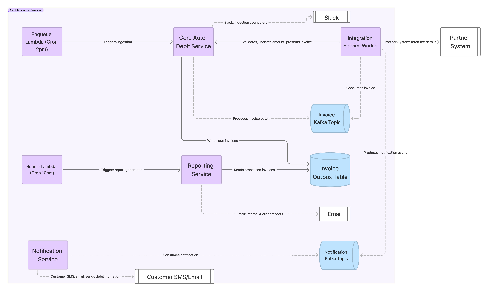

> **TL;DR:**
> How an asynchronous, stateful workflow supported 50K–60K invoice processing per day across roughly 400 partner systems.

## The problem

A consumer sets up a recurring debit mandate (NACH or UPI) against a fee due amount shown at the time of setup.
That amount is not guaranteed to stay correct until the actual debit date, because the source of truth, the partner's own system (ERP/Inhouse management system) can change it:

- a cash payment done reduces the balance amount to be collected
- a previously applied discount gets reverted, increasing the amount due
- a new discount gets applied, decreases the due amount
- the due date itself gets moved to a future date

Debiting a stale amount has real financial consequences. A wrong debit can result in a bounce and carry penalty charges for the end customer. So the amount presented for debit has to reflect the partner's current state, not the state at mandate-setup time.

**Why integrations, not just manual updates?**

The alternative, partners bulk-upload dues once a day, creates a single point of failure and forces the partner's system into a freeze window until the upload is processed.
That doesn't scale across partners with different operational rhythms, and it puts an availability constraint on someone else's system, which we don't control.

Instead, we fetch the latest details directly from each partner system, reconcile the delta against what's currently recorded, and adjust before presenting the invoice for debit.

**Why the 4 hour window specifically?**

- All due invoices need to be processed in a window of approx 4 hours.
- Many partners run their own updates (cash collection entries, discount changes) in the first half of the day. Fetching earlier risks pulling pre-update, stale data.
- Once an invoice is presented, we owe the customer a debit intimation notice. We don't want that notice going out late in the evening.

---

## Scale and shape of the problem

- **Volume is spiky, not steady.** Daily invoice counts range from ~1,000 to ~60,000, depending on the day of month and partner systems.
- **Bulk counts land on different days per partner.** Most partners settle their large volume on their own day of the month, so the 1,000-60,000 swing is largely a function of whose bulk day it is. The rare day when several partners' bulk days coincide is when we provision extra capacity by hand.
- **Partner heterogeneity.** Each partner runs its own tech stack, with its own release cycles, a partner-side fix or change can take weeks to months to ship. Partner team competence varies widely - some are well-staffed engineering teams, others have outsourced, slow-to-respond vendors.
- **Latency variance per partner is extreme** — anywhere from a few milliseconds to 15 seconds per request, and this is _unpredictable_ in advance.
- **Shared infrastructure contention.** This pipeline doesn't run in isolation. At the same time, the same core services are handling inbound webhooks from partners, outbound webhook dispatch to partners, high-volume push API traffic, and internal bulk uploads/report downloads. A spike in any of these can degrade the pull-and-present flow's throughput, and vice versa.
- **No safe prefetch/cache.** We can't fetch once and cache for the day - that reintroduces the staleness problem we're solving for. Every invoice needs a fresh fetch within the window.
- **Dual reporting requirement.** After processing, two different reports are generated: an internal report for ops/follow-up, and an external report for subscribed clients.

The core tension: a hard 4-hour window, partner latency we don't control, volume that swings 60x day-to-day, and shared infra that's busy with other traffic - all while correctness failures have direct financial consequences for end users.

---

## High-level architecture

### Stage 1 — Enqueue due invoices


flowchart TD
subgraph Enqueue["Enqueue Due Invoices"]
A[Cron @ 2pm] --> B[Lambda trigger]
B --> C[Core Auto-Debit Service]
C --> D[Async task: fetch all due invoices]
D --> E[(Outbox table)]
D --> F[Enqueue to Kafka in batches]
F --> G[Slack alert: ingestion count]
end


A 2pm cron triggers a Lambda, which hits the core auto-debit service. The core service kicks off an async task (Celery) that fetches all invoices due, writes them to the `PullInvoiceHistory` table using the **transactional outbox pattern**, and enqueues them to Kafka in batches sized to the day's volume. A Slack alert confirms the trigger fired and reports the invoice count for the day - this gives an early signal if the current day's volume looks abnormal before any processing starts. We can also have an alert to get the due invoice counts for next few days, so that we can plan for any infra changes needed.

### Stage 2 — Process enqueued invoices


flowchart TD
subgraph Process["Process enqueued invoices"]
H[Integration Service Worker] --> I{Invoice still in valid state?}
I -- no --> Skip[Skip / mark invalid]
I -- yes --> J[Fetch latest details from partner API]
J --> K[Diff: compute required update]
K --> L[Update core service with new amount/date]
L --> M{Still in valid state?}
M -- no --> Skip
M -- yes --> N[Present invoice for debit]
N --> O[Enqueue customer notification]
end


Integration service workers consume from Kafka and process invoices one at a time:

1. Check the invoice is still in a valid state (guards against races with other flows touching the same invoice).
2. Fetch the latest amount/due-date details from the partner system over HTTP.
3. Diff against current state to determine what update is needed.
4. Update the core services over internal HTTP calls.
5. Re-check valid state (the fetch + diff + update round-trip takes time, state may have changed).
6. Present the invoice for debit.
7. Enqueue a customer notification about the upcoming debit.

**Scope:** this workflow ends at presentation. Everything after it - whether the debit succeeded, whether it returned, and what happens next - belongs to the core subscription service, not the integration service.

### Stage 3 — Generate reports


flowchart TD
subgraph Report["Generate reports (10pm cron)"]
P[Cron @ 10pm] --> Q[Lambda trigger]
Q --> R[Integration Service]
R --> S[Read outbox table]
S --> T[Generate + email internal report]
S --> U[Generate + email external client report]
end


A 10pm cron triggers report generation, reading from the same outbox table populated in Stage 1 - so the report reflects exactly what was ingested and processed, not a live re-query that could double-count or miss records.

Two reports run on this data: an internal one at 6pm, which partner POCs use to see which cases need manual attention, and the partner-facing one at 10pm. Retries update the same outbox row in place, so a case that fails at 6pm and succeeds by 9pm shows as a success in the 10pm report - the 6pm report is a work queue, not a verdict.

---

## Integration Service

- Integration Service acts like an orchestrator, handling fetching data from external partner systems, figuring out if an update is needed, changes to be done and making HTTP requests to internal services to update the new state and finally presenting the invoice for debit.

- Integrations workers are running 24/7, even though we only use them for a few hours every day. We didn't need to do worker auto scaling, when needed for a few days a year, we could monitor and increase the resource on specific days as per the load.

- Each message can take up to ~5s to be processed successfully and multiple calls over HTTP are done (external and internal calls) in processing a single message.

- For each partner, we have configurable timeouts in integration service.

- Partner auth differs by integration: some systems want a username and password, others a secret or API key in a header. Whatever the partner specifies is carried as per-partner config in the integration service.

- Partner systems whitelist our egress IPs, and the responses we fetch are installment and due-amount records without customer-linked identifiers - so PII stays in the partner system and the core service rather than passing through the integration layer.

- For each partner we have configurable number of retries in case of failures while processing the invoice.

- At integration service, we have a default way of processing of invoices, per partner we could have custom implementations using the template method pattern.

- Duplicate ingestion is prevented by the key on `PullInvoiceHistory`: `request_id` (unique per enqueue job, so unique per day) plus `sequence_number` (the invoice's index in that day's list). Two rows for the same case within one run are impossible.

- There is deliberately no unique constraint on `invoice_id`. An invoice that failed yesterday has to be enqueued again on a later day under a new `request_id`, and a key on the invoice would block that retry.

- Re-presenting is safe by contract: if an invoice reaches the present call twice, the core service returns success with an "already presented" message rather than an error, so a retry after a partial failure is a no-op rather than a failure the worker has to interpret.

- Duplicate customer notification is handled by notification service.

- Deployments need to be managed to avoid disruption during this workflow.

## Capacity planning: how many workers do we need?



The 2pm–6pm window is fixed, so worker count is a direct function of per-invoice processing time and total volume for the day.

**Assumptions:**

- Processing window: 4 hours (14,400s)
- ~5% of due invoices are skipped before any partner call — subscription no longer valid, amount below the minimum, mandate not yet active. These cost milliseconds, so they count as ~0 worker-seconds.
- Of the invoices that do need a partner call, ~5% hit the 15s worst case; the rest average ~5s.

**Total processing time required, for 50,000 due invoices:**

$$
\text{Skipped} = 5\% \times 50{,}000 = 2{,}500 \text{ invoices} \approx 0 \text{ worker-seconds}
$$

$$
\text{Slow invoices} = 5\% \times 50{,}000 = 2{,}500 \text{ invoices} \times 15\text{s} = 37{,}500 \text{ worker-seconds}
$$

$$
\text{Average invoices} = 45{,}000 \times 5\text{s} = 225{,}000 \text{ worker-seconds}
$$

$$
\text{Total work} = 37{,}500 + 225{,}000 = 262{,}500 \text{ worker-seconds}
$$

**Workers required within the 4-hour window:**

$$
\text{Workers required} = \frac{262{,}500}{14{,}400} \approx 18.2 \Rightarrow \textbf{19 workers}
$$

That matches what we ran: about 20 workers on a 50K day, sitting a worker or two above the floor.

| Daily invoice volume | Minimum workers (mean 5.5s, 5% skipped) |
| -------------------- | --------------------------------------- |
| 1,000                | 1                                       |
| 10,000               | 4                                       |
| 25,000               | 10                                      |
| 50,000               | 19                                      |
| 60,000               | 22                                      |

**Sensitivity to the slow-invoice share:**

| Share of invoices at 15s | Workers required |
| ------------------------ | ---------------- |
| 0% (all at 5s)           | 17               |
| 5%                       | 19               |
| 10%                      | 20               |
| 20%                      | 24               |

**Caveat:** this model assumes work is evenly distributed across workers — any worker can pick up any invoice, with no clustering of slow invoices onto specific workers. That assumption carries the most risk here: a single degraded partner pins its 15s calls to one partition and serialises behind them. At the 19-worker floor the window is ~96% utilised, and queueing delay rises non-linearly as utilisation approaches 1, so a partner that goes slow in the last hour has no slack to absorb. On predicted heavy days we provision a few workers above the floor for exactly that reason.

---

## Observability

- Grafana dashboards to monitor service health / resource consumption.
  - For integration service, external partner call latency, MSK health

- Redash dashboards to query the outbox table to check for invoice state and counts.

## What happens when the window closes

Not every invoice finishes cleanly within the 4-hour window.

Two failure modes are handled operationally rather than automatically:

- **Messages stuck in an intermediate state** - an invoice that started processing but didn't reach a terminal state before the window closed. These require manual reprocessing.
- **Final state reached but not presented** - the invoice was validated and updated, but the present-for-debit step didn't complete due to a validation failure. These are also handled operationally rather than auto-retried.

Full automated recovery for every edge case at this volume wasn't worth the complexity, given how rarely these states occur in practice. Operational visibility makes manual intervention fast enough that it wasn't worth automating - so far.

---

## What we'd change if we built this today

None of the below is a defect in the running system - it clears 50-60K a day inside the window. These are the things we consciously deferred, plus the ones we understand better now than we did at design time.

**Isolation and failure containment**

- *Per-partner partitions and bulkheads.* Today any worker can pick up any invoice, so a degraded partner consumes shared capacity and its 15s calls serialise wherever the partition assigns them. Partitioning by partner key would let us scale a slow integration independently and cap its blast radius at its own share of the pool.
- *Circuit breaking with deadline awareness.* Retries are per-partner and unaware of window state. Three retries against a partner returning timeouts turns one 5.5s invoice into ~50 worker-seconds, and the window closes whether or not the work finished. We would trip a breaker on error rate and move that cohort to the reprocessing queue instead of spending window time on it.
- *Per-partner request budgets.* Some of the 15s tail is probably us exceeding a partner's rate limit rather than inherent latency. A request budget that honours `Retry-After` would remove tail latency we currently model as a given.

**Correctness**

- *Close the re-check/present gap properly.* The second validity check is advisory - state can change between it and the present call. The fix is compare-and-set on a version inside the core service's transaction, with a duplicate returning a conflict the worker treats as "already done" rather than a retryable failure.
- *One idempotency key across present and notification enqueue.* Present is already idempotent by contract, so a retry up to that point is harmless; the notification enqueue is the remaining step that leans on the notification service's own dedupe. Carrying the same key across both would let a retry resume rather than re-execute.
- *Pre-check the mandate ceiling during the diff.* "Required amount exceeds the registered mandate maximum" is deterministic - retrying cannot fix it - and it arrives in cohorts, because every customer on the affected plan trips it at once. Checking it in step 3 routes those to re-registration as a distinct terminal state instead of the manual queue.

**Operability**

- *A projection alert, not just dashboards.* The alert that matters fires at 3pm: "at current drain rate the queue finishes at 19:40 - window at risk." Grafana tells us what happened; that tells us early enough to act.
- *A DLQ and a re-drive tool.* Retries are configurable per partner, but the exhaustion path is implicit. A named destination plus a re-drive command would turn reprocessing into a button instead of a runbook step.
- *Scheduled scaling on lag.* The workers run 24/7 and we use them for four hours. Large bulk counts are spread across the month, so capacity is usually fine; the manual provisioning happens on the rare day when several partners' bulk days coincide. Cron-triggered scaling on consumer lag would cover those days without depending on someone remembering.
- *Deploy freeze enforced by CI, not discipline.* A rolling restart mid-window rebalances the consumer group and redelivers in-flight messages - removing capacity exactly when the window is tightest. That belongs in pipeline rules.
- *Automated invariants.* `ingested == presented + skipped + failed + parked`, checked at window close. Ops should read Redash to answer questions, not to discover discrepancies.
- *Parked-with-reason metrics.* Handing an invoice to a POC when the configured behaviour does not cover the case is deliberate - a wrong debit costs the customer far more than a failed run - but the *signal* could be better. Counting parked invoices by reason would turn config gaps into a visible backlog instead of a daily surprise during the window.

---

## Scaling it 20x: what the design looks like at 100K and 1M a day

The current shape was sized for 50-60K and works because three things were true: 20 partitions were enough consumer parallelism, one worker thread could hold one in-flight invoice, and every partner would accept our request rate inside a common 4-hour window. At 100K the first two bend and the third still holds. At 1M all three break, and capacity stops being the interesting constraint.

Running the same model forward:

| | 50K (today) | 100K | 1M |
| --- | --- | --- | --- |
| Worker-seconds required | 262,500 | 525,000 | 5,250,000 |
| Concurrency required in 4h | 18.2 → 19 | 36.5 → 37 | 364.6 → 365 |
| Sustained message rate | 3.5/s | 6.9/s | 69.4/s |
| Partitions at one in-flight per partition | 20 (current) | 37 | 365 |

### Ingestion: shard the sweep, stream the rows

At 100K, one job is still fine, but it should stream the due-list through a server-side cursor and bulk-insert in 5-10K chunks instead of materialising the list in the application. Publishing should be a relay over the outbox rows, not a second write from the same code path. *Why:* the 2pm sweep is one large write burst, and a single 100K-row transaction holds locks and WAL for its whole duration while a crash at 90% throws away the run.

At 1M, shard the sweep by partner cohort — one ingestion job per shard, each with its own `request_id` of `date + shard`. *Why:* a million rows in one transaction is minutes of WAL, and retrying a failed run means re-deriving a million invoices. Per-shard `request_id`s make progress partial and retries cheap, and the outbox key `(request_id, sequence_number)` keeps working unchanged — `sequence_number` just restarts per shard.

### Queue: keep it keyless, add partitions carefully

Keep Kafka, keep no partition key, raise the count: roughly 40-60 partitions at 100K, 120-200 at 1M.

*Why keyless is still right at 20x:* you do not need ordering — dedupe is on the row key and present is idempotent by contract — and a partner key would be actively harmful. With 400 partners and 60x volume skew, a partner carrying 25% of a 1M day puts 250K messages on a single partition and serialises the whole window behind itself. Default partitioning spreads load evenly; partner isolation belongs in the consumer as a per-partner semaphore, not in partition assignment.

*Why not 365 partitions:* partition count is only a parallelism ceiling if you assume one in-flight message per partition. Once consumers multiplex, 120 partitions each feeding 3-5 concurrent requests covers 365 in-flight without paying for rebalance time, file handles and leader elections.

### Workers: stop paying for a thread per in-flight request

This is the change that matters, because the arithmetic says the work is not compute.

At 100K: an async worker (asyncio plus aiohttp or equivalent) holding 20-25 concurrent partner calls per task, so two or three tasks cover the window. At 1M: fifteen tasks at 25 concurrent, or eight at 50.

*Why async:* a 5s invoice spends almost all of that waiting on someone else's HTTP endpoint. At ~30ms of CPU per invoice, a million invoices is roughly 2 vCPU sustained across the entire four-hour window. Buying 365 request slots by paying for 365 containers is paying twenty times over for the same idle time.

*Why the fleet should be elastic rather than 24/7:* the same fleet provisioned continuously costs about $12,900/month on-demand at 1M (92 `m6i.xlarge` hosts at four worker containers each); scheduled to exist only for the window, on Spot, about $800; async on Fargate Spot, about $60-150 with real headroom. The 4-hour window is a gift for cost — a fixed daily peak is the easiest shape to schedule against.

*Why scale on projected finish time and not CPU:* CPU sits near idle by design, so a CPU alarm never fires before the deadline. The signal that matters is the queue lag expressed in invoice-seconds and the projected finish time; if ETA exceeds the deadline minus a safety margin, add capacity, and if it lands early, scale in.

*Why Spot is safe here:* interruptions redeliver messages, and republishing is harmless because present returns "already presented". At 100K, Lambda is a reasonable alternative — the per-invoice work fits well inside a function invocation — but at 1M the sustained 70/s rate, VPC/NAT egress and reserved concurrency make long-lived Spot tasks cheaper and simpler.

### Partners: the window has to become per-partner

At 100K the global 2pm-6pm window still works. Enforce it with a per-partner token bucket, a per-partner semaphore (bulkhead) so one slow integration cannot consume the shared pool, and a breaker that stops retrying a partner whose error rate has collapsed — three retries against a 15s timeout turns one 5.5s invoice into ~50 worker-seconds, and the window closes regardless.

At 1M the constraint moves to the partner side:

| Partner share of a 1M day | Invoices | Required rate to finish in 4h | Duration at a 2 req/s cap |
| --- | --- | --- | --- |
| 5% | 50,000 | 3.5/s | 6.9h |
| 10% | 100,000 | 6.9/s | 13.9h |
| 25% | 250,000 | 17.4/s | 34.7h |

No amount of our capacity fixes a partner that will not accept the rate. So at 1M the single global window has to be replaced with per-partner scheduling: fetch after that partner's own cutoff, present before its intimation deadline, and stagger cohorts across the day. *Why this is the correct decision rather than adding workers:* the equation is bounded by the smallest of our concurrency and the partner's rate limit, and at 1M the partner is usually smaller. Staggering also flattens our peak, which is what makes the scheduled-Spot numbers above achievable — a smoother curve needs fewer purchased slots.

The second half of that decision is deadline-aware admission: if a cohort's projected finish exceeds its deadline, stop admitting it and park the remainder with a reason, rather than half-processing everything and finishing nothing on time. A parked invoice that a POC resolves tomorrow is a better outcome than a debit presented after the intimation window.

### Presentation and storage: batch the calls, partition the rows

At 100K the presentation path is roughly 24 internal calls/second — 3-4 per invoice — which a handful of replicas absorb. At 1M it is ~240/s plus a million row updates, and that is the point where per-invoice RPC becomes the bill of materials: a bulk present endpoint that takes 50 per call and returns per-item results cuts both the call count and the transaction count by an order of magnitude. *Why correctness survives batching:* idempotency is defined per item, so a partially failed batch retries item by item and duplicates still return success.

Storage stays in Postgres with monthly range partitions. At 1M/day that is 365M rows a year, roughly 165GB — size is not the problem; write rate and vacuum are. Partitioning keeps the live index small, and closing a month becomes a detach plus a Parquet export to S3 rather than a delete. *Why not DynamoDB:* the access pattern is date-range scans for the reports plus point updates by row key, and Postgres serves both while keeping the Redash queries ops relies on.

### Notifications: the cost centre that dwarfs the infrastructure

At 50K invoices a day, an SMS intimation at roughly ₹0.20 is about $120/day. At 1M it is about **$2,400/day — around $72,000 a month**, against a compute bill measured in tens or hundreds of dollars. Notifications are the only line item here that grows linearly with volume and has no Spot market.

*So the design decision at 1M is channel selection, not throughput:* push or email wherever the mandate type permits, digest multiple upcoming debits where the regulation allows one message, and reserve SMS for the statutory intimation. That is a product and compliance decision shaped by the same volume curve as the workers, and it deserves to be made deliberately rather than inherited.

### What stays exactly as it is

The outbox with `(request_id, sequence_number)`, idempotent present returning success for a duplicate, per-partner configuration via the template method, and the decision to hand an ambiguous case to a POC rather than guess at an amount. What changes with scale is the plumbing around those decisions, not the decisions themselves — usually a sign they were right.

*Cost figures above are modelled, not billed: us-east-1 on-demand `m6i.xlarge` at $0.192/h, Spot at roughly 30% of on-demand, Fargate Spot at $0.0127/vCPU-hour, 30 days, four to five hours of fleet life per day. Treat them as one significant figure.*
