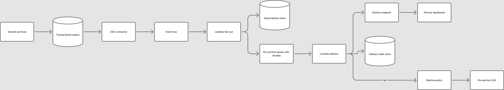

> **TL;DR:**
> The production design in [the current webhook platform write-up](/blog/webhooks-platform/) held roughly 100K events a day with six always-on workers. Ten times that volume, with spikes that arrive without warning, is not the same system at a larger size — it is a different shape.
> The ideal design moves durability to the source with a transactional outbox, fans out with serverless functions instead of a fixed worker pool, and isolates every partner behind its own throttled queue with its own dead-letter queue.

This is a thought experiment grounded in the real constraints of the system we built, not a proposal for what we ran. The point is the design, and where the current design deliberately stops being the right answer.

## Why the current design does not simply scale

The current design works at its scale because three properties happen to hold:

- **Volume is low enough that a fixed pool is cheap.** Six workers clear 100K events a day because most partner endpoints acknowledge in a few hundred milliseconds. The pool is sized for the spike and sits mostly idle the rest of the time — acceptable at six instances, expensive at the size needed for 1M events a day.
- **The operational surface is small.** A dead-letter queue inspected by hand, a disable threshold that stops traffic on failure, a manual reconstruction for the events we never published. These are human-in-the-loop controls that work while the failure rate is low and the team is small.
- **Isolation is coarse.** Two topics, priority and non-priority, with no per-partner limit. At 400 partners this was fine; the blast radius of a burst was bounded only by the shared pool.

Scale breaks each of these. A fixed pool sized for a 10x spike means paying for capacity that is idle most of the time. A hand-inspected dead-letter queue at 10x the volume is not a queue, it is an incident. And coarse isolation means one partner's degraded endpoint can, during a burst, consume the shared pool and delay every other partner's priority events.

The current design also carries three gaps that scale turns into outages: no transactional outbox between the business change and the published event, no per-partner rate limiting, and no metric for events that should have been produced but weren't.

## Design principles for 10x

1. **Durability at every boundary.** No step in the path from business change to delivered webhook is allowed to lose the event silently. The weakest link in the current design was the gap between "the business action happened" and "a message reached the topic" — the outage was exactly that gap.
2. **Isolation is per partner, not per class.** A noisy or failing partner must be able to degrade only itself.
3. **Scale elastically, not proactively.** The load is spiky and unpredictable, so capacity should follow load rather than sit idle waiting for it.
4. **Automate the recovery the current design does by hand.** DLQ triage, replay, and absence detection should be observable and, where possible, self-healing.

## The ideal architecture

### Stage 1 — Transactional outbox and change data capture

The business service that completes a payment writes two things in one database transaction: the business record, and a row in an **outbox table** describing the event that must eventually be published. Nothing is published yet, and nothing can be lost — the event is durably recorded in the same transaction as the state change.

A **change-data-capture connector** (Debezium, or a managed equivalent) reads the outbox table's binlog and streams new rows to an event bus. A relay marks each row published once its message is safely on the bus. This closes the exact gap that caused the outage in the current design: there is now a durable record of every event the system owes, and a relay that cannot silently stop — if it stalls, the outbox table grows and the lag is visible.

The cost is a write to the outbox on every business change, and the operational complexity of running CDC. At 10x the value is that the "events that were never published" class of failure stops existing.

### Stage 2 — Event bus with partitioning

The event bus (a managed Kafka or a Kinesis stream) carries the published events. Partitions are keyed so that events for the same partner, or the same event type, land in the same partition — this preserves any ordering a partner needs and lets throughput scale by adding partitions rather than by guessing at a fixed worker count.

The bus is the buffer that absorbs the spike. A bulk settlement run produces a block of events; they land on the bus in seconds and are drained at whatever rate the downstream stages can sustain, without the producer ever blocking.

### Stage 3 — Serverless fan-out

A serverless function consumes the bus and fans each event out to its subscriptions: for every active subscription matching the event type, it enqueues a delivery task onto that partner's queue.

Serverless is the right tool here because fan-out is bursty and the per-event work is small. The current design runs a fixed worker pool 24/7; at 10x that idle cost is real. A function scales with the fan-out and down to zero when quiet, so we pay for the work, not for the waiting.

### Stage 4 — Per-partner throttled queues

This is the isolation the current design lacked. Every partner gets its own queue with its own concurrency limit and throttle rate. A partner whose endpoint is slow or failing is bounded to its own budget; it cannot consume the shared pool and delay another partner's priority events.

The throttle is also the answer to the requirement the current design never implemented: not overwhelming a partner with concurrency. Here it is enforced per partner, first attempts and retries alike, with a separate budget for retries so a partner's outage does not amplify into a flood of retry traffic.

### Stage 5 — Serverless delivery with idempotency and per-partner DLQ

A delivery function pulls from a partner's queue, builds the payload, signs it, and POSTs it with a short timeout. Delivery state and idempotency keys live in a key-value store keyed by `event_id`, so the function can answer "have we already delivered this" before spending a call, and a partner can dedupe on the same key.

Retries use the queue's native redrive policy rather than an application-level backoff scheduler, and each partner has its own dead-letter queue. DLQ growth per partner is a metric and an alarm — a partner whose endpoint broke an hour ago lights up its own DLQ, and an on-call engineer sees which partner, not just that something failed.

### Stage 6 — Partner dashboard and observability

The partner dashboard is an API-backed service: subscribe, inspect delivery history, and replay from the DLQ without a ticket. Replay is an explicit operation with a bound — a maximum number of events and a rate — because unlimited replay is a way to accidentally re-DoS a partner's endpoint.

Observability is where the current design's blind spot is fixed directly. Alongside delivery latency and DLQ volume, there is a **per-event-type publication rate with a lower bound**: the outbox table tells us how many events should have been published, and the bus tells us how many were. A divergence is an alert. The system can now answer "did we miss something", which it couldn't before.

## What serverless buys, and what it costs

The shift from a fixed worker pool to serverless functions is the central trade, and it isn't free.

**It buys:** elastic capacity that follows the spike instead of sitting idle, no capacity-planning guesswork for the fan-out and delivery stages, and a smaller blast radius because each partner is isolated in its own queue.

**It costs:** per-request pricing instead of per-instance pricing — fine when the work is bursty, worse if the load were steady, in which case a fixed pool would be cheaper. Cold starts add latency to the first request after idle, which matters for the priority path and is mitigated with provisioned concurrency on that one function. And serverless shifts operational burden to the platform provider, which means trusting managed services for the bus, the queues, and the key-value store rather than running them ourselves.

The honest version is that serverless is the right answer for the fan-out and delivery stages precisely because the load is spiky and the per-event work is small. It is not obviously the right answer for a hypothetical steady, high-throughput stream, and the choice should be revisited if the load profile ever flattens.

## What 10x still cannot give you

Three things the ideal design improves but does not eliminate:

- **Exactly-once delivery is still impossible.** The design reduces duplicates and makes them cheap to dedupe, but a retried delivery after a timeout can still arrive twice. Idempotency stays a partner requirement.
- **Partner heterogeneity stays hard.** A partner with a slow, outsourced, slow-to-fix endpoint is still a first-class problem. The per-partner queue contains the damage; it doesn't make the partner reliable.
- **Payload evolution is still a contract we must keep.** The `version` field in the envelope is the escape hatch; using it responsibly is a discipline, not a feature.

## Where this leaves the current design

The current design is not wrong — it is the right design for the scale it served, and it shipped, carried ~100K events a day, and taught us exactly which gaps matter when you grow. The ideal design is what I would build knowing what I know now: durability at the source so events can't vanish, isolation per partner so a failure can't spread, and elasticity so we pay for what we use.

If the platform were starting today at 1M events a day, I would build the outbox and the per-partner queues first, because those two are the ones that turn an outage into a lagging relay and a noisy neighbor into a contained one.
