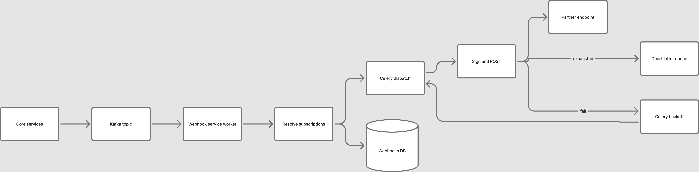

> **TL;DR:**
> Core services published domain events to Kafka, a webhook service fanned each event out to every subscribed partner, and Celery retried deliveries with exponential backoff up to three attempts before moving them to a dead-letter queue.
> Around 100K events a day reached roughly 400 partner systems across two Kafka topics, with no per-partner rate limiting, no transactional outbox, and a replay path that was a manual reconstruction. One of those three omissions cost us a day of missing events.

## The problem

As an integration platform we accepted data from partner systems through push APIs. Partners called us; we stored the invoice, the payment, the mandate. The reverse direction — us telling them something changed — did not exist.

So they polled. A partner would loop over their open invoices, re-fetch a payment's latest state every few seconds, poll settlement details in the hope that a batch had landed. For one invoice that is tolerable. For four hundred partner systems doing it concurrently, it is a self-inflicted load test that never ends.

The failures compound in a way that makes polling hard to fix with throttling alone:

- **We cannot tell what the partner has already consumed.** A 200 response looks identical whether it carried new information or the same state as ten minutes ago. The correct data is still not the data they needed, so they poll again.
- **Polling frequency is not ours to set.** Rate limits cap requests per minute; they do not stop a partner from spreading the same intent across a thousand calls, or from looping sequentially through every open case and blocking their own user while they do it.
- **The cost lands on shared infrastructure.** Every polling read competes with the synchronous path that real users are waiting on, and the teams generating the load are not the teams feeling it.

Polling is a pull system with no knowledge of when the state changed. What both sides actually want is a push: tell the partner at the moment the state changes, once, with enough information for them to act.

## What a webhook changes

The moment a payment succeeds inside our system, a partner's user should be unblocked on the partner's platform. That is a latency requirement in seconds, not minutes — and it is the same requirement on every event of that class.

Two classes of events emerged, with different promises:

| Class | Example event | Delivery target | Why it matters |
| --- | --- | --- | --- |
| Priority | `payment.debited`, NACH debit setup done | As close to real time as possible | Blocks a user flow on the partner's side until delivered |
| Non-priority | `payment.settled`, `flex.downpayment.settled`, `cred.loan.application_started` | Same day at least | Reconciliation and reporting; no user waiting |

That split is not cosmetic. It decides queue priority, it decides which events are worth paging someone about, and it decides what a backlog means when you look at a dashboard.

The event taxonomy is small and stable: a handful of events per product — payments, subscriptions, credit applications, student master data — each with a fixed payload shape. The taxonomy is also the public contract: partners subscribe to event types, and the payload for each type is documented. That documentability is the constraint that shapes the delivery design — a payload can never change shape without breaking a partner who has no versioning on the other end.

## Scale and shape of the problem

- **~100K events per day**, roughly 1.2 per second on average — and averages are useless here. Volume is spiky: payment attempts cluster, and upstream bank settlement runs produce bulk bursts from internal services that arrive as one large block rather than a trickle.
- **Fan-out multiplies every event.** With roughly 400 partners and an average of six subscribed event types each, a subscription count around 2,400 sits between the event and the HTTP request. One event is not one delivery.
- **Partner latency varies by two orders of magnitude.** A well-built partner endpoint acknowledges in a hundred-odd milliseconds; others take seconds to write to their system. We cannot treat them uniformly and we cannot fix them — a partner-side fix can take weeks.
- **Shared infrastructure contention.** The webhook service calls internal services over HTTP to construct payloads. A burst of events becomes a burst of internal API calls, against services that are also serving the synchronous product path.
- **No revert.** Once an event is delivered, we cannot unsend it. If the payload is wrong, we don't know what the partner did with it, and there is no compensating call that reliably repairs their data. The only defence is to get the payload right before it leaves.
- **Partner teams must be able to self-serve.** Integration is done by people outside our team, on their release schedule. Every step that requires a ticket to us is a step that stalls their launch.

The consistency requirement is at-least-once. On a payment event, a duplicate that a partner can deduplicate is survivable; a silent miss that leaves a user blocked is not. That choice sets up everything else in this post: retries exist because delivery can fail, and idempotency is not optional because retries mean duplicates.

## High-level architecture

### Stage 1 — Publish

Core services emit a domain event by pushing a message to a Kafka topic. Delivery is the consumer's problem, not the producer's — a service that just completed a payment writes to Kafka and returns.

The message carries the identity of the business object and the event type; the payload is constructed downstream, per event type.

### Stage 2 — Consume and fan out


flowchart TD
subgraph Consume["Webhook service: consume"]
A[Kafka topic] --> B[Webhook worker]
B --> C{Subscriptions for event type?}
C -- none --> D[Drop: nothing subscribed]
C -- N subscriptions --> E[Create one delivery record per subscription]
E --> F[(Webhooks DB)]
E --> G[Dispatch to topic-specific worker pool]
end


A long-running webhook worker consumes the topic and resolves the event to subscriptions: for each active subscription matching the event type, it writes a delivery record to the webhooks database and hands off to dispatch.

There are **two topics, and two worker pools**: `priority_webhooks` with three workers, and `non-priority_webhooks` with three workers. The event's class decides which topic it lands in, so a payment success is never queued behind a settlement report from a partner that is slow to acknowledge.

The write-then-dispatch order matters. The row in the webhooks database is the only durable record that this event was ever supposed to go to this partner. It is what support reads when a partner says "we never got it", and it is what makes the failure visible rather than inferred.

### Stage 3 — Deliver


flowchart TD
subgraph Deliver["Deliver"]
G[Celery task per delivery] --> H[Build payload for event type]
H --> I[Attach partner headers + sign]
I --> J[POST to partner endpoint]
J --> K{Response}
K -- 2xx --> L[Mark delivered]
K -- timeout 15s --> M[Attempt failed]
K -- 4xx/5xx --> M
M --> N[Persist attempt + response]
N --> O{Attempts left?}
O -- yes --> P[Celery retry, exponential backoff]
P --> G
O -- no --> Q[Move to dead-letter queue]
end


Each delivery is a Celery task: build the payload for this event type, attach the partner's configured headers, sign it, POST it, and record the outcome. Every attempt has a **15-second timeout**. That number is deliberately short — a partner whose endpoint needs longer than 15 seconds to acknowledge is not acknowledging, and holding a worker open to find out costs capacity we need elsewhere.

On failure the task is re-enqueued with an exponential backoff countdown. When the three attempts are exhausted, the message is not silently dropped: it moves to a dead-letter queue. DLQ items are inspected by hand — the persisted attempt trail shows the status codes and bodies we received — and once the underlying cause is understood, the events are replayed.

The worker tier runs 24/7. Event arrival is not schedulable, so neither is the worker pool; we sized for the spike rather than scaling on a schedule.

### The payload: a fixed envelope

Every delivery carries the same envelope, with a payload that varies by event type:

| Field | Meaning |
| --- | --- |
| `event_id` | Unique id for this webhook event |
| `event` | The event type, e.g. `payment.debited` |
| `timestamp` | Unix time the event originated |
| `version` | Payload format version, `1.0` |
| `payload` | Event-specific data (payment, student, application, …) |

The envelope is the contract. `event_id` is the dedupe key a partner should store; `event` decides which handler runs; `version` is the field that would let the payload evolve without a breaking change — and the fact that it has been pinned at `1.0` since launch is a silent promise we have had to keep.

## What "at least once" actually promises

Being precise about the guarantee matters more than the phrase, because the partner's implementation depends on this paragraph.

**What the platform guarantees:** every event matching an active subscription is attempted at least once, every attempt is recorded, and a delivery is only marked complete on a 2xx.

**What it does not guarantee:**

- **Exactly once.** Retries, timeouts, and the possibility of a duplicate publish after a manual reconstruction all permit a second delivery of the same business event.
- **Ordering.** Two events for the same invoice can arrive in either order. Nothing in the design serialises them per partner.
- **Bounded delivery time.** Priority events are queued ahead; nothing enforces a deadline.

**What the partner must implement:** an idempotent handler. We provide two keys to dedupe on: the `event_id` in the envelope, which is unique per delivery, and the business identifier inside the payload (payment id, invoice id, mandate id), which is stable across deliveries of the same business event. We documented `event_id` as the primary dedupe key and the business id as the fallback for partners whose systems cannot store an opaque event id — a payment gateway, for instance, can key on the payment it already knows.

<!-- TODO(fact): confirm the fallback was documented this way, and whether the business id is stable across a re-emission. -->

## Isolation and fairness: what we did and did not build

The design brief said we should not overwhelm a partner with concurrency — first attempts and retries alike. That requirement was not implemented. There was no per-partner concurrency cap and no per-partner requests-per-second limit; the only natural limiter was the worker pool itself, and the only bound on retry amplification was three attempts.

At 100K events a day the omission didn't bite: roughly 250 deliveries a day for an average partner is nothing, and the retry budget is small. But it is a fair criticism of the design, and it is the first thing I would add before growing the partner count — the platform's blast radius on a partner's infrastructure is currently unbounded, and during a bulk burst we can hand a single partner a large block of concurrent requests with no signal that we are doing it.

**What bounded the load instead:** fan-out isolation per event type in the subscription model, exponential backoff so retries spread out rather than stack, and a hard attempt ceiling so no event retries forever. The disabled-subscription state (below) stops traffic to a partner that is failing rather than degrading them, which was the more pressing failure mode in practice.

### Capacity: what three workers per topic actually meant

The 15-second timeout is a ceiling on a stuck endpoint, not the per-delivery cost. Most partner endpoints acknowledge in a few hundred milliseconds, so a worker's real throughput is far above one delivery per 15 seconds. The timeout only bites when a partner's endpoint hangs, and in that case it bounds how long one worker is held by a dead request.

The binding constraint is therefore the tail, not the mean. Three workers per topic cleared the priority queue because priority deliveries are dominated by fast acks. The non-priority queue, with the same three workers, backed up during bulk settlement bursts from upstream — a large settlement run produces a block of settlement events at once, and a same-day target tolerates that backlog, which is exactly why that traffic was routed to the non-priority topic in the first place.

The model that made three workers per topic defensible is simple: worst case, every attempt times out at 15 seconds, one worker clears 86,400 ÷ 15 = 5,760 deliveries a day, and three workers clear 17,280. At sub-second acks the same three workers clear an order of magnitude more. The gap between those two numbers is the headroom that made the small pool work — and the gap is what disappears the moment a partner's endpoint starts hanging, which is the condition the DLQ exists to catch.

<!-- TODO(fact): did we ever actually hit a sustained backlog on the priority topic, or only non-priority? And what was the instance size behind those six workers? -->

## Retry, backoff, and the end of the line


flowchart LR
A[Attempt 1] -->|fail| B[Celery retry, backoff]
B --> C[Attempt 2]
C -->|fail| D[Celery retry, backoff]
D --> E[Attempt 3]
E -->|fail| F[Dead-letter queue]
F --> G[Attempt trail: every response persisted]
H[Failure count per hour] -.-> A
A -->|fail| H
H -->|>= 10 per event type| I[Disable subscription]
H -->|>= 100 per partner| I
I --> J[Email notification to subscribed address]
J --> K[Partner fixes endpoint, replay from DLQ]
K --> A


Retries use exponential backoff with a **maximum of three attempts** by default. Every attempt is persisted with its response, so a terminal failure is not a mystery: support and the partner can read the exact status codes and bodies we received, in order.

Two policies end the line for a subscription, both measured over a **one-hour window**:

- **10 failures for a single event type** disables that subscription's delivery of that event type.
- **100 failures for a single partner** disables that partner's subscriptions entirely.

Both thresholds exist for the same reason: to stop us from hammering an endpoint that is already failing. A partner whose system is down for an hour should not have us sending it hundreds of retries that pile into a backlog; disabling after a bounded, short-window count means we fail fast and stop rather than degrade.

On disabling, an email goes to the address captured at subscription time. Disabling is reversible and deliberately so: the partner fixes their endpoint, and the events are replayed from the dead-letter queue. Stopping was the more valuable half of the design — a partner with a broken endpoint is usually also not watching a dashboard, and continuing to retry into a dead endpoint just accumulates a backlog that makes replay expensive later.

## Security: proving the request came from us

Partner endpoints are public URLs, which means anyone can POST to them. Two mechanisms let a partner verify the source:

- **A custom header**, configured per subscription with a partner-chosen key and value, attached to every request. A partner whose infrastructure filters on headers can require it and reject anything that doesn't carry it.
- **A dedicated `security_key` header** carrying the secret the partner configured, so the partner's server can validate the request against a value it already knows.
- **HMAC over the payload**, for partners who want cryptographic verification that the request was sent by us and not forged in transit.

Both are partner-side configuration. The platform's job is to make them available, sign consistently, and keep the secret handling boring.

<!-- TODO(fact): is there a timestamp or replay window on the signature, and are secrets rotatable without a delivery outage? The docs don't show one; don't claim one exists. -->

## Partner self-service

The brief was that subscribing, debugging, and replaying should be doable by the partner without opening a ticket with us. What exists:

- **Subscription management** — the partner registers an endpoint, chooses event types, sets the signing secret, and records the failure-notification email.
- **A dashboard** — the partner logs into Jodo's integration dashboard and sees the webhooks triggered for their account and their delivery status.
- **Attempt history** per delivery, including the response body, so both sides debug from the same evidence.

The evidence trail is the part that matters operationally. "We never received it" is the most common partner support message and the least useful one; a delivery record with three attempts and their status codes turns it into a shared timeline with an obvious next action.

<!-- TODO(fact): is replay of a failed event something the partner triggers from the dashboard, or an internal action after the DLQ is resolved? -->

## The outage: events that were never published

A release updated an environment variable on a core service. The Celery queue name pointed at the wrong Redis queue. Core services continued completing payments and continued creating the task that prepares and enqueues the webhook event — but the task was written to a queue nothing was consuming, so no message ever reached the Kafka topic.

**Blast radius:** two event types were affected. No webhook was emitted for them for the duration between the release and detection.

**Detection:** not by an alert. I noticed it while debugging, and the path through the system is instructive because it is the reverse of how the system was designed to be inspected:

1. The webhook delivery records had no entries for the affected event types.
2. The Kafka topic had no messages for them either — so the failure was upstream of the webhook service.
3. The Celery task result table showed the enqueue task executing without the expected downstream effect.
4. Service logs identified it: the core service was creating the task, and the task was landing on a queue nobody consumed.

Nothing in that chain was observable from a dashboard, and no alert fired, because the platform was healthy by every measure it had instrumented. It measured deliveries that existed. It had no signal for events that should have existed and didn't.

**Fix:** point the environment variable at the correct queue and redeploy the core service — a one-line change.

**Recovery:** fetch every case after the deployment timestamp and re-emit the events for them. This worked only because the business objects were still queryable and the request that produced each event was reconstructible from state. Partners with idempotent handlers absorbed the re-emission without double-counting; this is the exact scenario idempotency was documented for.

**What it proves:** with no outbox, the system had no record of the events it owed anyone. The recovery was a query written after the fact by the person who happened to know what to look for. Had the affected window been longer, or the affected event type one whose triggering state had since been overwritten, reconstruction would have been impossible.

## What I would do differently

**Add the outbox first.** The publish step needs a durable intent record written in the same transaction as the business change, with a relay that publishes and marks it done. That single change turns the outage above into a lagging relay with a visible backlog and an automatic retry — and it turns "which events did we owe and not send" into a query rather than an investigation.

**Alert on the absence of events, not only on failed deliveries.** Every metric we had described work the platform had done: deliveries attempted, retries, failures. None described work it had not done. A per-event-type publication rate with a lower bound would have caught this in minutes — a null observation, which is exactly what an alerting strategy built on error rates tends to miss.

**Add per-partner rate limiting and concurrency caps before scaling the partner count.** The requirement was in the design brief and never shipped. At 400 partners and 100K events it was unnecessary; at 1,000 partners and a bulk burst it would be the difference between a partner's degraded service and their incident.

**Measure end-to-end delivery latency.** We never had a p50/p99 for event-created to event-delivered. Without it, the priority queue is a design intention rather than a verified property, and no one can say whether "close to real time" meant 200ms or 40 seconds.

## Scaling this 10x

Everything above is the design for the scale we actually served — ~100K events a day, six always-on workers. Ten times that volume, with spikes that arrive without warning, is not the same system larger; it is a different shape. The short version: move durability to the source with a transactional outbox so events can't vanish, fan out and deliver with serverless functions instead of a fixed pool so we pay for the work and not the idle, and isolate every partner behind its own throttled queue with its own dead-letter queue so a noisy neighbor can only degrade itself.

The full design — the stages, the serverless trade-offs, and what 10x still can't give you — is in the companion article: **[Scaling webhooks 10x: an ideal design](/blog/webhooks-platform-10x/)**.

## How it was observed

The service had a Grafana overview dashboard for its own health — instance metrics and event counts — and an MSK dashboard for queue lag. The gap the outage exposed was not in that instrumentation; it was the absence of a metric that would have measured something we never produced. The dashboards answered "are we working"; they could not answer "did we miss something".
